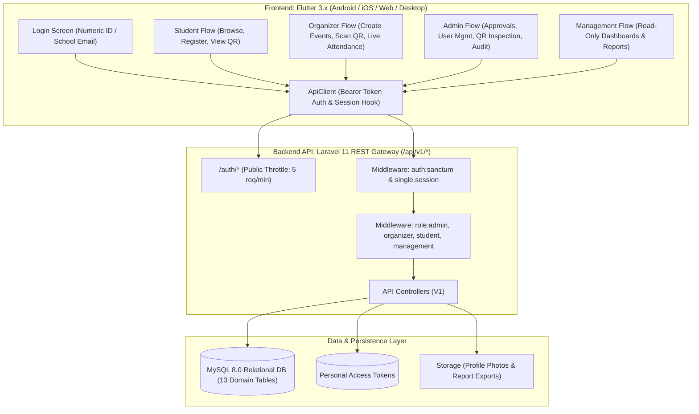
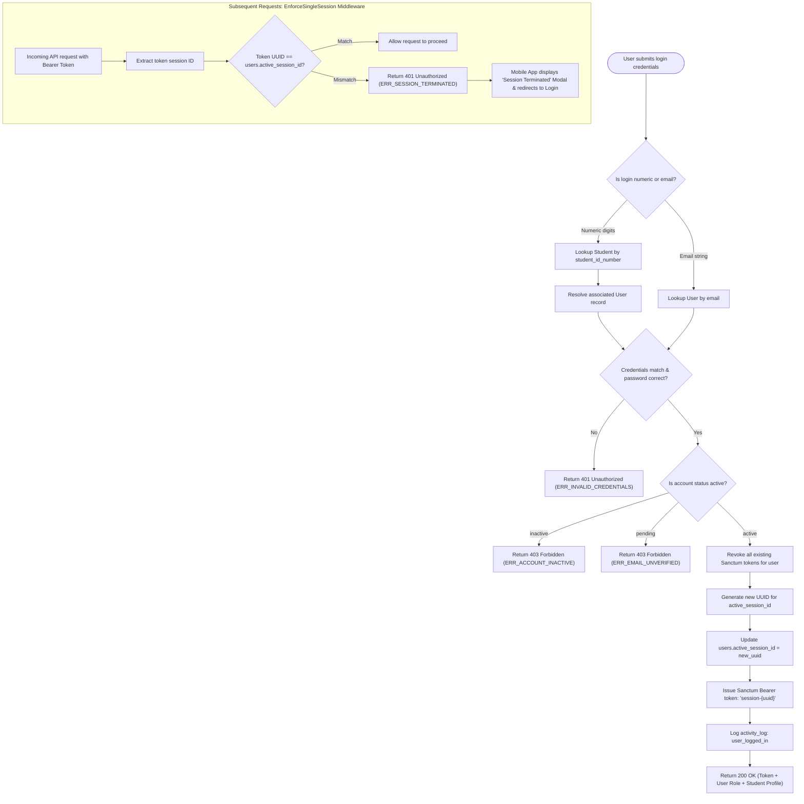
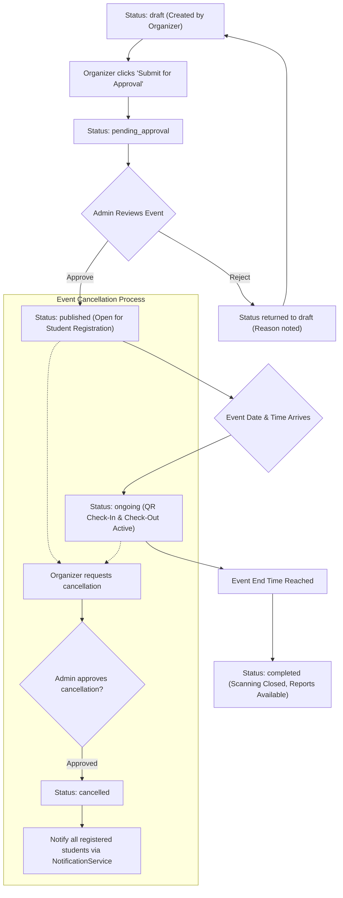
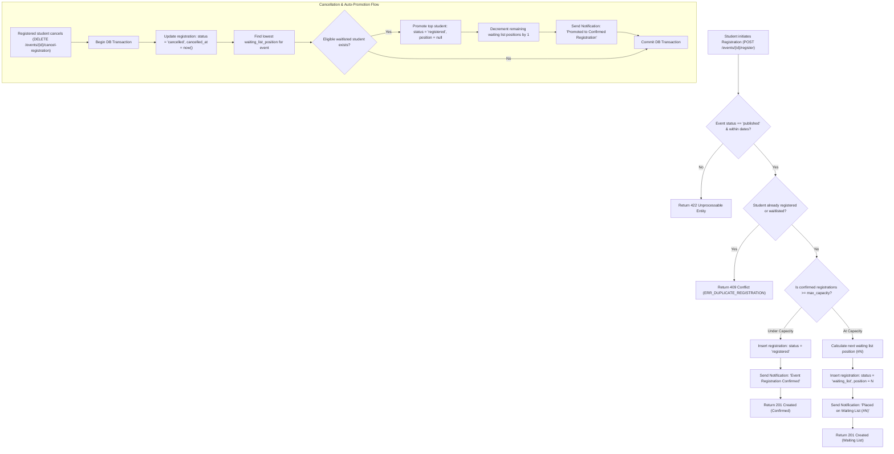
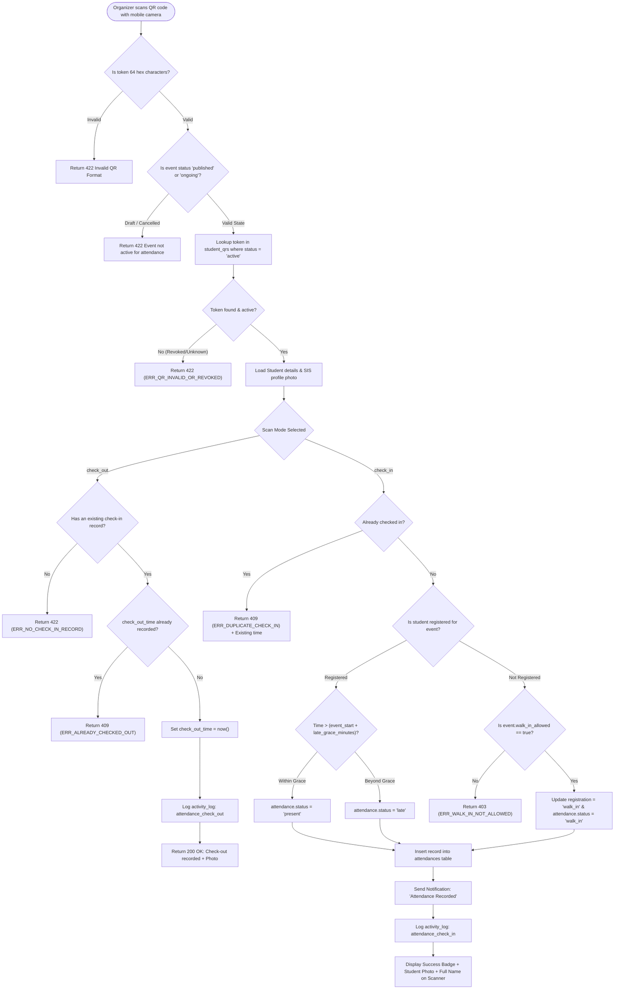
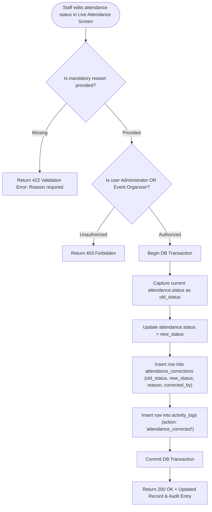
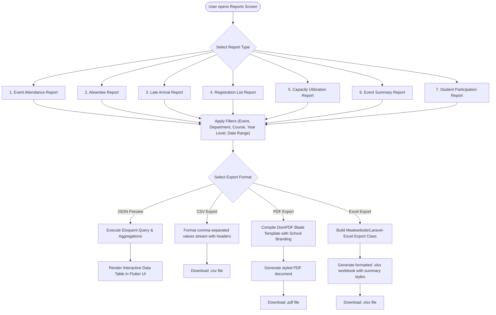

# School Event Registration & QR-Based Attendance Management System
## Comprehensive System Flowcharts & Process Workflows

This document outlines the end-to-end architecture, role-based workflows, lifecycle state machines, and data processing logic based directly on the inspected system source code.

---

## Table of Contents

1. [High-Level System Architecture](#1-high-level-system-architecture)
2. [Authentication & Single-Session Enforcement Workflow](#2-authentication--single-session-enforcement-workflow)
3. [Event Lifecycle & Administrative Approval Governance](#3-event-lifecycle--administrative-approval-governance)
4. [Student Permanent QR Identity & Atomic Reissuance](#4-student-permanent-qr-identity--atomic-reissuance)
5. [Event Registration & Waiting List Auto-Promotion](#5-event-registration--waiting-list-auto-promotion)
6. [QR Attendance Scanning (Check-In & Check-Out) Engine](#6-qr-attendance-scanning-check-in--check-out-engine)
7. [Manual Attendance Correction & Audit Trail](#7-manual-attendance-correction--audit-trail)
8. [Institutional Reporting & Export Pipeline](#8-institutional-reporting--export-pipeline)

---

## 1. High-Level System Architecture

The platform operates as a decoupled client-server architecture. The Flutter mobile/web client communicates exclusively through JSON REST endpoints over HTTPS. Direct database access from client applications is prohibited.

---

## 2. Authentication & Single-Session Enforcement Workflow

Users authenticate using either their numeric **Student ID** (e.g., `20260001`) or **Institutional Email**. When a user logs in from a new device, any existing active sessions are terminated immediately.

---

## 3. Event Lifecycle & Administrative Approval Governance

Organizers create events in `draft` mode. Events must be reviewed and approved by an Administrator before becoming visible for registration and attendance scanning.

---

## 4. Student Permanent QR Identity & Atomic Reissuance

Each student is assigned a **permanent cryptographic QR token** containing **no embedded PII**. If a student loses their physical badge or suspects their QR code is compromised, they can reissue it instantly.

```mermaid
flowchart TD
    subgraph InitialGeneration["QR Retrieval (GET /api/v1/student/qr)"]
        ReqQR["Student navigates to Permanent QR screen"] --> FetchActive["Fetch active StudentQR record"]
        FetchActive --> Exists{"Active QR exists?"}
        Exists -- "Yes" --> RenderCode["Render QR code using qr_flutter (64-char hex string)"]
        Exists -- "No" --> GenInitial["Generate bin2hex(random_bytes(32)) & status = active"]
        GenInitial --> RenderCode
    end

    subgraph AtomicReissue["QR Reissue (POST /api/v1/student/qr/reissue)"]
        ReissueReq["Student or Admin initiates QR Reissue"] --> BeginTx["Begin Database Transaction"]
        BeginTx --> RevokeOld["Update existing active tokens: status = 'revoked', revoked_at = now()"]
        RevokeOld --> GenFresh["Generate new 64-char cryptographic hex token"]
        GenFresh --> InsertNew["Insert new student_qrs row (status = 'active')"]
        InsertNew --> LogAudit["Log activity_logs: qr_token_reissued"]
        LogAudit --> CommitTx["Commit Transaction"]
        CommitTx --> ReturnNewToken["Return new QR token & update screen instantly"]
    end
```

---

## 5. Event Registration & Waiting List Auto-Promotion

Student event registrations strictly enforce capacity limits. When slots fill, students join an ordered waiting list. If a registered student cancels, the system automatically promotes the next waiting student.

---

## 6. QR Attendance Scanning (Check-In & Check-Out) Engine

The attendance scanner supports both **Check-In** and **Check-Out** modes. The scanner validates event state, verifies permanent QR tokens, calculates late arrival grace periods, handles unregistered walk-ins, and presents on-screen photo verification for staff.

---

## 7. Manual Attendance Correction & Audit Trail

Organizers and Administrators can manually adjust an attendance record (e.g., from `absent` or `late` to `excused` or `present`). Every correction requires a documented reason and writes to both `attendance_corrections` and `activity_logs`.

---

## 8. Institutional Reporting & Export Pipeline

The system provides 7 comprehensive institutional report types. Authorized users can filter and export data across three standard formats: **JSON** (live preview), **CSV**, **PDF**, and **Excel (`.xlsx`)**.

---

## Summary of Key Verification & Rule Gates

| Component | Security & Business Rule | Verification Location in Source |
|---|---|---|
| **Single-Session** | Only 1 active device session; previous tokens revoked on login | [`AuthController.php`](file:///C:/Users/ThinkPad%20L14/Downloads/bahala%20nani/School-Event-Registration-and-QR-Based-Attendance/backend/app/Http/Controllers/Api/V1/AuthController.php#L70-L79), [`EnforceSingleSession.php`](file:///C:/Users/ThinkPad%20L14/Downloads/bahala%20nani/School-Event-Registration-and-QR-Based-Attendance/backend/app/Http/Middleware/EnforceSingleSession.php) |
| **Permanent QR** | 64-char random hex token with zero PII; atomic reissue | [`StudentQRController.php`](file:///C:/Users/ThinkPad%20L14/Downloads/bahala%20nani/School-Event-Registration-and-QR-Based-Attendance/backend/app/Http/Controllers/Api/V1/StudentQRController.php#L58-L90) |
| **Event Governance** | Administrator approval required before publishing or cancelling | [`EventController.php`](file:///C:/Users/ThinkPad%20L14/Downloads/bahala%20nani/School-Event-Registration-and-QR-Based-Attendance/backend/app/Http/Controllers/Api/V1/EventController.php#L200-L240) |
| **Auto-Promotion** | Transactional promotion of next waitlist student on cancellation | [`RegistrationController.php`](file:///C:/Users/ThinkPad%20L14/Downloads/bahala%20nani/School-Event-Registration-and-QR-Based-Attendance/backend/app/Http/Controllers/Api/V1/RegistrationController.php#L160-L210) |
| **Late Arrival** | Automatic detection using `event_date + start_time + late_grace_period_minutes` | [`AttendanceController.php`](file:///C:/Users/ThinkPad%20L14/Downloads/bahala%20nani/School-Event-Registration-and-QR-Based-Attendance/backend/app/Http/Controllers/Api/V1/AttendanceController.php#L173-L182) |
| **Audit Trail** | All state-changing actions logged with user, IP, and metadata | [`ActivityLog.php`](file:///C:/Users/ThinkPad%20L14/Downloads/bahala%20nani/School-Event-Registration-and-QR-Based-Attendance/backend/app/Models/ActivityLog.php), [`ActivityLog::log()`](file:///C:/Users/ThinkPad%20L14/Downloads/bahala%20nani/School-Event-Registration-and-QR-Based-Attendance/backend/app/Models/ActivityLog.php#L32-L48) |
