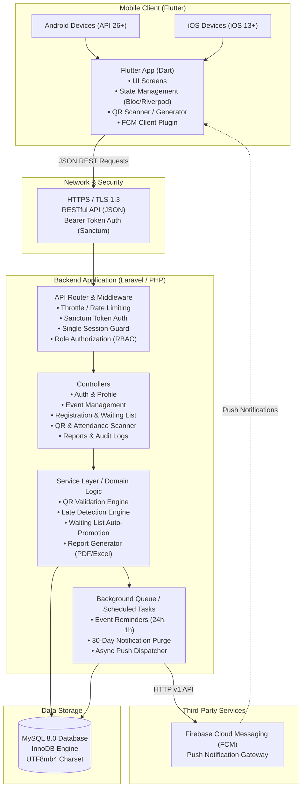
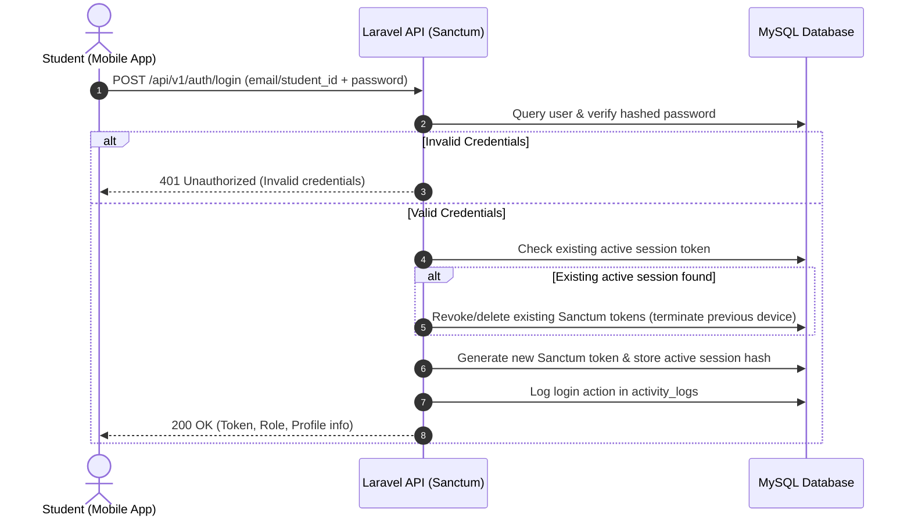
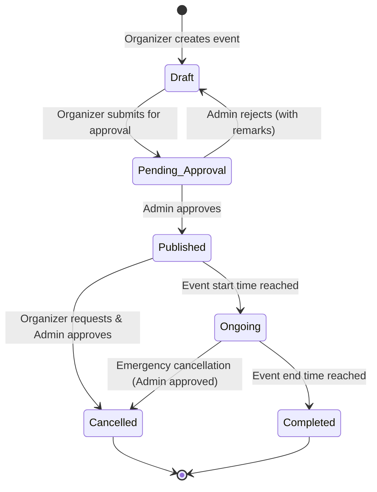
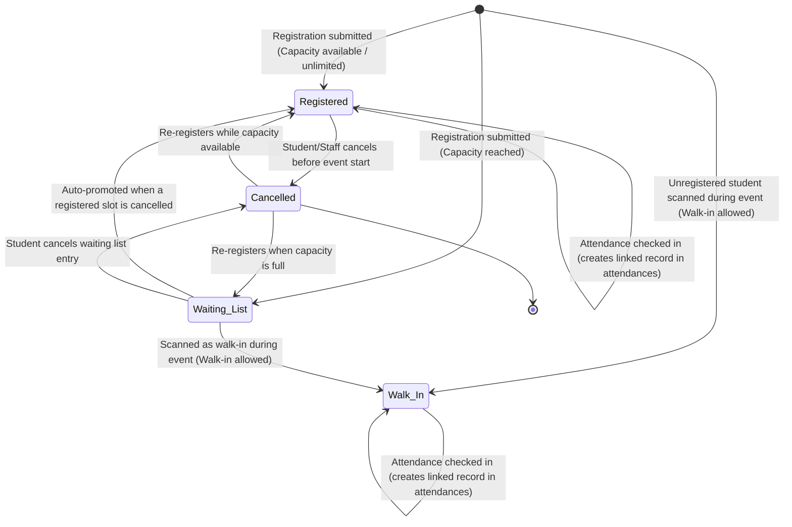
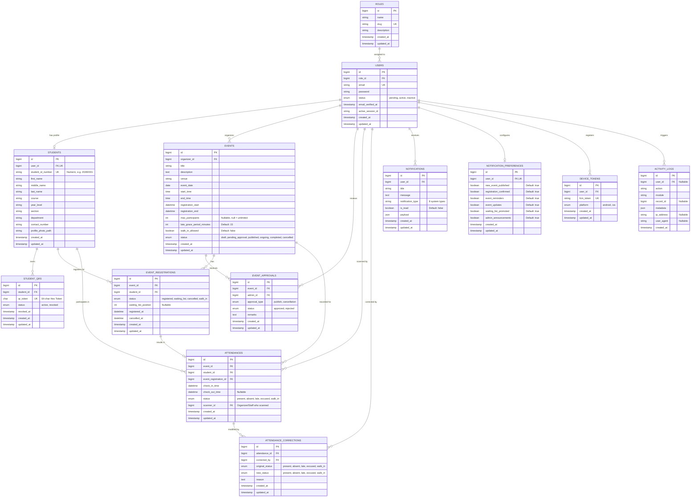

# System Architecture and Database Schema Design

## School Event Registration and QR-Based Attendance Management System
**Document Version:** 1.0  
**Associated SRS Version:** 1.1 (Finalized Baseline)  
**Date:** 2026-10-08  
**Backend:** Laravel 11 / PHP 8.3+  
**Database:** MySQL 8.0+  
**Mobile Framework:** Flutter 3.x (Dart 3.x) — Android 8.0+ / iOS 13+  
**External Services:** Firebase Cloud Messaging (FCM)

---

# 1. System Architecture

## 1.1 High-Level Architecture Overview

The system follows a modern multi-tier, client-server decoupled architecture where the Flutter mobile client interacts exclusively with the backend via HTTPS JSON REST APIs.



---

## 1.2 Authentication & Session Flow (Single Session Enforcement)



---

## 1.3 QR Attendance & Verification Flow (Check-In)

```mermaid
sequenceDiagram
    autonumber
    actor Organizer as Organizer / Staff
    participant Mobile as Scanner Mobile UI
    participant API as Laravel REST API
    participant DB as MySQL Database

    Organizer->>Mobile: Select Event & Set Scanner Mode to Check-In
    Mobile->>Organizer: Ready camera viewfinder
    actor Student as Student
    Student->>Organizer: Present Permanent QR (64-char Hex)
    Organizer->>Mobile: Scan QR Code
    Mobile->>API: POST /api/v1/events/{id}/attendance/scan {qr_token, mode: "check_in"}
    API->>DB: Validate QR token exists & is active
    alt QR Invalid or Revoked
        API-->>Mobile: 422 Unprocessable (QR invalid/revoked)
        Mobile-->>Organizer: Display Error Banner (Red)
    else QR Valid
        API->>DB: Resolve student profile (photo, full name, student ID)
        API->>DB: Verify event is currently ongoing/open
        API->>DB: Check if check-in already recorded
        alt Check-In Already Recorded
            API-->>Mobile: 409 Conflict (Already checked in at [time])
            Mobile-->>Organizer: Display Duplicate Warning (Yellow)
        else Fresh Check-In
            API->>DB: Check registration status
            alt Unregistered & Walk-In Disallowed
                API-->>Mobile: 403 Forbidden (Student not registered; walk-in not permitted)
                Mobile-->>Organizer: Display Not Registered Banner
            else Eligible (Registered OR Walk-In Enabled)
                API->>API: Determine Status (Present vs. Late vs. Walk-In)<br/>Current Time > Start Time + Grace Period?
                API->>DB: Create attendance record (store scanner_id)
                alt Walk-In Student
                    API->>DB: Auto-create event_registration (status: 'walk_in')
                end
                API->>DB: Log attendance in activity_logs
                API-->>Mobile: 200 OK (Student Photo, Name, Status: Present/Late/Walk-in, Time)
                Mobile-->>Organizer: Display Verification Card (Photo, Name, Status Badge)
                Organizer->>Organizer: Visually confirm student matches displayed photo
            end
        end
    end
```

---

## 1.4 Event Lifecycle State Machine



---

## 1.5 Registration & Waiting List State Machine



> **Note:** `event_registrations.status` strictly uses `ENUM('registered', 'waiting_list', 'cancelled', 'walk_in')`. Checking in at an event does not change `event_registrations.status` to a separate `attended` state; instead, it creates a linked record in the `attendances` table (`status`: `present`, `late`, `absent`, `excused`, or `walk_in`).

---

# 2. Database Entity-Relationship (ER) Diagram



---

# 3. Complete MySQL Schema DDL (Data Definition Language)

Below is the production-ready MySQL 8.0 DDL script with full foreign key constraints, indexes, unique constraints, and character encodings.

```sql
-- ============================================================================
-- School Event Registration and QR-Based Attendance Management System
-- Database Schema Definition (MySQL 8.0+)
-- ============================================================================

SET FOREIGN_KEY_CHECKS = 0;

-- ----------------------------------------------------------------------------
-- 1. Table: roles
-- ----------------------------------------------------------------------------
DROP TABLE IF EXISTS `roles`;
CREATE TABLE `roles` (
    `id` BIGINT UNSIGNED NOT NULL AUTO_INCREMENT,
    `name` VARCHAR(50) NOT NULL,
    `slug` VARCHAR(50) NOT NULL,
    `description` VARCHAR(255) NULL,
    `created_at` TIMESTAMP NULL DEFAULT CURRENT_TIMESTAMP,
    `updated_at` TIMESTAMP NULL DEFAULT CURRENT_TIMESTAMP ON UPDATE CURRENT_TIMESTAMP,
    PRIMARY KEY (`id`),
    UNIQUE KEY `roles_slug_unique` (`slug`)
) ENGINE=InnoDB DEFAULT CHARSET=utf8mb4 COLLATE=utf8mb4_unicode_ci;

-- ----------------------------------------------------------------------------
-- 2. Table: users
-- ----------------------------------------------------------------------------
DROP TABLE IF EXISTS `users`;
CREATE TABLE `users` (
    `id` BIGINT UNSIGNED NOT NULL AUTO_INCREMENT,
    `role_id` BIGINT UNSIGNED NOT NULL,
    `email` VARCHAR(191) NOT NULL,
    `password` VARCHAR(255) NOT NULL,
    `status` ENUM('pending', 'active', 'inactive') NOT NULL DEFAULT 'pending',
    `email_verified_at` TIMESTAMP NULL DEFAULT NULL,
    `active_session_id` VARCHAR(255) NULL DEFAULT NULL,
    `remember_token` VARCHAR(100) NULL DEFAULT NULL,
    `created_at` TIMESTAMP NULL DEFAULT CURRENT_TIMESTAMP,
    `updated_at` TIMESTAMP NULL DEFAULT CURRENT_TIMESTAMP ON UPDATE CURRENT_TIMESTAMP,
    PRIMARY KEY (`id`),
    UNIQUE KEY `users_email_unique` (`email`),
    KEY `users_role_id_foreign` (`role_id`),
    KEY `users_status_index` (`status`),
    CONSTRAINT `fk_users_role_id` FOREIGN KEY (`role_id`) REFERENCES `roles` (`id`) ON DELETE RESTRICT ON UPDATE CASCADE
) ENGINE=InnoDB DEFAULT CHARSET=utf8mb4 COLLATE=utf8mb4_unicode_ci;

-- ----------------------------------------------------------------------------
-- 3. Table: students
-- ----------------------------------------------------------------------------
DROP TABLE IF EXISTS `students`;
CREATE TABLE `students` (
    `id` BIGINT UNSIGNED NOT NULL AUTO_INCREMENT,
    `user_id` BIGINT UNSIGNED NOT NULL,
    `student_id_number` VARCHAR(30) NOT NULL,
    `first_name` VARCHAR(100) NOT NULL,
    `middle_name` VARCHAR(100) NULL DEFAULT NULL,
    `last_name` VARCHAR(100) NOT NULL,
    `course` VARCHAR(100) NOT NULL,
    `year_level` VARCHAR(20) NOT NULL,
    `section` VARCHAR(50) NOT NULL,
    `department` VARCHAR(100) NOT NULL,
    `contact_number` VARCHAR(25) NOT NULL,
    `profile_photo_path` VARCHAR(255) NULL DEFAULT NULL,
    `created_at` TIMESTAMP NULL DEFAULT CURRENT_TIMESTAMP,
    `updated_at` TIMESTAMP NULL DEFAULT CURRENT_TIMESTAMP ON UPDATE CURRENT_TIMESTAMP,
    PRIMARY KEY (`id`),
    UNIQUE KEY `students_user_id_unique` (`user_id`),
    UNIQUE KEY `students_student_id_number_unique` (`student_id_number`),
    KEY `students_course_year_index` (`course`, `year_level`),
    KEY `students_department_index` (`department`),
    CONSTRAINT `fk_students_user_id` FOREIGN KEY (`user_id`) REFERENCES `users` (`id`) ON DELETE CASCADE ON UPDATE CASCADE
) ENGINE=InnoDB DEFAULT CHARSET=utf8mb4 COLLATE=utf8mb4_unicode_ci;

-- ----------------------------------------------------------------------------
-- 4. Table: student_qrs
-- ----------------------------------------------------------------------------
DROP TABLE IF EXISTS `student_qrs`;
CREATE TABLE `student_qrs` (
    `id` BIGINT UNSIGNED NOT NULL AUTO_INCREMENT,
    `student_id` BIGINT UNSIGNED NOT NULL,
    `qr_token` CHAR(64) NOT NULL,
    `status` ENUM('active', 'revoked') NOT NULL DEFAULT 'active',
    `revoked_at` TIMESTAMP NULL DEFAULT NULL,
    `created_at` TIMESTAMP NULL DEFAULT CURRENT_TIMESTAMP,
    `updated_at` TIMESTAMP NULL DEFAULT CURRENT_TIMESTAMP ON UPDATE CURRENT_TIMESTAMP,
    PRIMARY KEY (`id`),
    UNIQUE KEY `student_qrs_qr_token_unique` (`qr_token`),
    KEY `student_qrs_student_id_status_index` (`student_id`, `status`),
    CONSTRAINT `fk_student_qrs_student_id` FOREIGN KEY (`student_id`) REFERENCES `students` (`id`) ON DELETE CASCADE ON UPDATE CASCADE
) ENGINE=InnoDB DEFAULT CHARSET=utf8mb4 COLLATE=utf8mb4_unicode_ci;

-- ----------------------------------------------------------------------------
-- 5. Table: events
-- ----------------------------------------------------------------------------
DROP TABLE IF EXISTS `events`;
CREATE TABLE `events` (
    `id` BIGINT UNSIGNED NOT NULL AUTO_INCREMENT,
    `organizer_id` BIGINT UNSIGNED NOT NULL,
    `title` VARCHAR(200) NOT NULL,
    `description` TEXT NOT NULL,
    `venue` VARCHAR(200) NOT NULL,
    `event_date` DATE NOT NULL,
    `start_time` TIME NOT NULL,
    `end_time` TIME NOT NULL,
    `registration_start` DATETIME NOT NULL,
    `registration_end` DATETIME NOT NULL,
    `max_participants` INT UNSIGNED NULL DEFAULT NULL,
    `late_grace_period_minutes` INT UNSIGNED NOT NULL DEFAULT 15,
    `walk_in_allowed` TINYINT(1) NOT NULL DEFAULT 0,
    `status` ENUM('draft', 'pending_approval', 'published', 'ongoing', 'completed', 'cancelled') NOT NULL DEFAULT 'draft',
    `created_at` TIMESTAMP NULL DEFAULT CURRENT_TIMESTAMP,
    `updated_at` TIMESTAMP NULL DEFAULT CURRENT_TIMESTAMP ON UPDATE CURRENT_TIMESTAMP,
    PRIMARY KEY (`id`),
    KEY `events_organizer_id_index` (`organizer_id`),
    KEY `events_status_event_date_index` (`status`, `event_date`),
    CONSTRAINT `fk_events_organizer_id` FOREIGN KEY (`organizer_id`) REFERENCES `users` (`id`) ON DELETE RESTRICT ON UPDATE CASCADE
) ENGINE=InnoDB DEFAULT CHARSET=utf8mb4 COLLATE=utf8mb4_unicode_ci;

-- ----------------------------------------------------------------------------
-- 6. Table: event_approvals
-- ----------------------------------------------------------------------------
DROP TABLE IF EXISTS `event_approvals`;
CREATE TABLE `event_approvals` (
    `id` BIGINT UNSIGNED NOT NULL AUTO_INCREMENT,
    `event_id` BIGINT UNSIGNED NOT NULL,
    `admin_id` BIGINT UNSIGNED NOT NULL,
    `approval_type` ENUM('publish', 'cancellation') NOT NULL,
    `status` ENUM('approved', 'rejected') NOT NULL,
    `remarks` TEXT NULL DEFAULT NULL,
    `created_at` TIMESTAMP NULL DEFAULT CURRENT_TIMESTAMP,
    `updated_at` TIMESTAMP NULL DEFAULT CURRENT_TIMESTAMP ON UPDATE CURRENT_TIMESTAMP,
    PRIMARY KEY (`id`),
    KEY `event_approvals_event_id_index` (`event_id`),
    KEY `event_approvals_admin_id_index` (`admin_id`),
    CONSTRAINT `fk_event_approvals_event_id` FOREIGN KEY (`event_id`) REFERENCES `events` (`id`) ON DELETE CASCADE ON UPDATE CASCADE,
    CONSTRAINT `fk_event_approvals_admin_id` FOREIGN KEY (`admin_id`) REFERENCES `users` (`id`) ON DELETE RESTRICT ON UPDATE CASCADE
) ENGINE=InnoDB DEFAULT CHARSET=utf8mb4 COLLATE=utf8mb4_unicode_ci;

-- ----------------------------------------------------------------------------
-- 7. Table: event_registrations
-- ----------------------------------------------------------------------------
DROP TABLE IF EXISTS `event_registrations`;
CREATE TABLE `event_registrations` (
    `id` BIGINT UNSIGNED NOT NULL AUTO_INCREMENT,
    `event_id` BIGINT UNSIGNED NOT NULL,
    `student_id` BIGINT UNSIGNED NOT NULL,
    `status` ENUM('registered', 'waiting_list', 'cancelled', 'walk_in') NOT NULL DEFAULT 'registered',
    `waiting_list_position` INT UNSIGNED NULL DEFAULT NULL,
    `registered_at` DATETIME NOT NULL DEFAULT CURRENT_TIMESTAMP,
    `cancelled_at` DATETIME NULL DEFAULT NULL,
    `created_at` TIMESTAMP NULL DEFAULT CURRENT_TIMESTAMP,
    `updated_at` TIMESTAMP NULL DEFAULT CURRENT_TIMESTAMP ON UPDATE CURRENT_TIMESTAMP,
    PRIMARY KEY (`id`),
    UNIQUE KEY `event_reg_event_student_unique` (`event_id`, `student_id`),
    KEY `event_reg_student_id_index` (`student_id`),
    KEY `event_reg_status_waiting_pos_index` (`event_id`, `status`, `waiting_list_position`),
    CONSTRAINT `fk_event_reg_event_id` FOREIGN KEY (`event_id`) REFERENCES `events` (`id`) ON DELETE CASCADE ON UPDATE CASCADE,
    CONSTRAINT `fk_event_reg_student_id` FOREIGN KEY (`student_id`) REFERENCES `students` (`id`) ON DELETE CASCADE ON UPDATE CASCADE
) ENGINE=InnoDB DEFAULT CHARSET=utf8mb4 COLLATE=utf8mb4_unicode_ci;

-- ----------------------------------------------------------------------------
-- 8. Table: attendances
-- ----------------------------------------------------------------------------
DROP TABLE IF EXISTS `attendances`;
CREATE TABLE `attendances` (
    `id` BIGINT UNSIGNED NOT NULL AUTO_INCREMENT,
    `event_id` BIGINT UNSIGNED NOT NULL,
    `student_id` BIGINT UNSIGNED NOT NULL,
    `event_registration_id` BIGINT UNSIGNED NOT NULL,
    `check_in_time` DATETIME NOT NULL DEFAULT CURRENT_TIMESTAMP,
    `check_out_time` DATETIME NULL DEFAULT NULL,
    `status` ENUM('present', 'absent', 'late', 'excused', 'walk_in') NOT NULL DEFAULT 'present',
    `scanner_id` BIGINT UNSIGNED NULL DEFAULT NULL,
    `created_at` TIMESTAMP NULL DEFAULT CURRENT_TIMESTAMP,
    `updated_at` TIMESTAMP NULL DEFAULT CURRENT_TIMESTAMP ON UPDATE CURRENT_TIMESTAMP,
    PRIMARY KEY (`id`),
    UNIQUE KEY `attendances_event_student_unique` (`event_id`, `student_id`),
    KEY `attendances_student_id_index` (`student_id`),
    KEY `attendances_reg_id_index` (`event_registration_id`),
    KEY `attendances_scanner_id_index` (`scanner_id`),
    KEY `attendances_status_index` (`status`),
    CONSTRAINT `fk_attendances_event_id` FOREIGN KEY (`event_id`) REFERENCES `events` (`id`) ON DELETE CASCADE ON UPDATE CASCADE,
    CONSTRAINT `fk_attendances_student_id` FOREIGN KEY (`student_id`) REFERENCES `students` (`id`) ON DELETE CASCADE ON UPDATE CASCADE,
    CONSTRAINT `fk_attendances_reg_id` FOREIGN KEY (`event_registration_id`) REFERENCES `event_registrations` (`id`) ON DELETE CASCADE ON UPDATE CASCADE,
    CONSTRAINT `fk_attendances_scanner_id` FOREIGN KEY (`scanner_id`) REFERENCES `users` (`id`) ON DELETE SET NULL ON UPDATE CASCADE
) ENGINE=InnoDB DEFAULT CHARSET=utf8mb4 COLLATE=utf8mb4_unicode_ci;

-- ----------------------------------------------------------------------------
-- 9. Table: attendance_corrections
-- ----------------------------------------------------------------------------
DROP TABLE IF EXISTS `attendance_corrections`;
CREATE TABLE `attendance_corrections` (
    `id` BIGINT UNSIGNED NOT NULL AUTO_INCREMENT,
    `attendance_id` BIGINT UNSIGNED NOT NULL,
    `corrected_by` BIGINT UNSIGNED NOT NULL,
    `original_status` ENUM('present', 'absent', 'late', 'excused', 'walk_in') NOT NULL,
    `new_status` ENUM('present', 'absent', 'late', 'excused', 'walk_in') NOT NULL,
    `reason` TEXT NOT NULL,
    `created_at` TIMESTAMP NULL DEFAULT CURRENT_TIMESTAMP,
    `updated_at` TIMESTAMP NULL DEFAULT CURRENT_TIMESTAMP ON UPDATE CURRENT_TIMESTAMP,
    PRIMARY KEY (`id`),
    KEY `att_corr_attendance_id_index` (`attendance_id`),
    KEY `att_corr_corrected_by_index` (`corrected_by`),
    CONSTRAINT `fk_att_corr_attendance_id` FOREIGN KEY (`attendance_id`) REFERENCES `attendances` (`id`) ON DELETE CASCADE ON UPDATE CASCADE,
    CONSTRAINT `fk_att_corr_corrected_by` FOREIGN KEY (`corrected_by`) REFERENCES `users` (`id`) ON DELETE RESTRICT ON UPDATE CASCADE
) ENGINE=InnoDB DEFAULT CHARSET=utf8mb4 COLLATE=utf8mb4_unicode_ci;

-- ----------------------------------------------------------------------------
-- 10. Table: notifications
-- ----------------------------------------------------------------------------
DROP TABLE IF EXISTS `notifications`;
CREATE TABLE `notifications` (
    `id` BIGINT UNSIGNED NOT NULL AUTO_INCREMENT,
    `user_id` BIGINT UNSIGNED NOT NULL,
    `title` VARCHAR(150) NOT NULL,
    `message` TEXT NOT NULL,
    `notification_type` VARCHAR(50) NOT NULL,
    `is_read` TINYINT(1) NOT NULL DEFAULT 0,
    `payload` JSON NULL DEFAULT NULL,
    `created_at` TIMESTAMP NULL DEFAULT CURRENT_TIMESTAMP,
    `updated_at` TIMESTAMP NULL DEFAULT CURRENT_TIMESTAMP ON UPDATE CURRENT_TIMESTAMP,
    PRIMARY KEY (`id`),
    KEY `notifications_user_is_read_index` (`user_id`, `is_read`),
    KEY `notifications_created_at_index` (`created_at`),
    CONSTRAINT `fk_notifications_user_id` FOREIGN KEY (`user_id`) REFERENCES `users` (`id`) ON DELETE CASCADE ON UPDATE CASCADE
) ENGINE=InnoDB DEFAULT CHARSET=utf8mb4 COLLATE=utf8mb4_unicode_ci;

-- ----------------------------------------------------------------------------
-- 11. Table: notification_preferences
-- ----------------------------------------------------------------------------
DROP TABLE IF EXISTS `notification_preferences`;
CREATE TABLE `notification_preferences` (
    `id` BIGINT UNSIGNED NOT NULL AUTO_INCREMENT,
    `user_id` BIGINT UNSIGNED NOT NULL,
    `new_event_published` TINYINT(1) NOT NULL DEFAULT 1,
    `registration_confirmed` TINYINT(1) NOT NULL DEFAULT 1,
    `event_reminders` TINYINT(1) NOT NULL DEFAULT 1,
    `event_updates` TINYINT(1) NOT NULL DEFAULT 1,
    `waiting_list_promoted` TINYINT(1) NOT NULL DEFAULT 1,
    `admin_announcements` TINYINT(1) NOT NULL DEFAULT 1,
    `created_at` TIMESTAMP NULL DEFAULT CURRENT_TIMESTAMP,
    `updated_at` TIMESTAMP NULL DEFAULT CURRENT_TIMESTAMP ON UPDATE CURRENT_TIMESTAMP,
    PRIMARY KEY (`id`),
    UNIQUE KEY `notif_pref_user_id_unique` (`user_id`),
    CONSTRAINT `fk_notif_pref_user_id` FOREIGN KEY (`user_id`) REFERENCES `users` (`id`) ON DELETE CASCADE ON UPDATE CASCADE
) ENGINE=InnoDB DEFAULT CHARSET=utf8mb4 COLLATE=utf8mb4_unicode_ci;

-- ----------------------------------------------------------------------------
-- 12. Table: device_tokens
-- ----------------------------------------------------------------------------
DROP TABLE IF EXISTS `device_tokens`;
CREATE TABLE `device_tokens` (
    `id` BIGINT UNSIGNED NOT NULL AUTO_INCREMENT,
    `user_id` BIGINT UNSIGNED NOT NULL,
    `fcm_token` VARCHAR(255) NOT NULL,
    `platform` ENUM('android', 'ios') NOT NULL,
    `created_at` TIMESTAMP NULL DEFAULT CURRENT_TIMESTAMP,
    `updated_at` TIMESTAMP NULL DEFAULT CURRENT_TIMESTAMP ON UPDATE CURRENT_TIMESTAMP,
    PRIMARY KEY (`id`),
    UNIQUE KEY `device_tokens_fcm_token_unique` (`fcm_token`),
    KEY `device_tokens_user_id_index` (`user_id`),
    CONSTRAINT `fk_device_tokens_user_id` FOREIGN KEY (`user_id`) REFERENCES `users` (`id`) ON DELETE CASCADE ON UPDATE CASCADE
) ENGINE=InnoDB DEFAULT CHARSET=utf8mb4 COLLATE=utf8mb4_unicode_ci;

-- ----------------------------------------------------------------------------
-- 13. Table: activity_logs
-- ----------------------------------------------------------------------------
DROP TABLE IF EXISTS `activity_logs`;
CREATE TABLE `activity_logs` (
    `id` BIGINT UNSIGNED NOT NULL AUTO_INCREMENT,
    `user_id` BIGINT UNSIGNED NULL DEFAULT NULL,
    `action` VARCHAR(100) NOT NULL,
    `module` VARCHAR(50) NOT NULL,
    `record_id` BIGINT UNSIGNED NULL DEFAULT NULL,
    `metadata` JSON NULL DEFAULT NULL,
    `ip_address` VARCHAR(45) NULL DEFAULT NULL,
    `user_agent` VARCHAR(255) NULL DEFAULT NULL,
    `created_at` TIMESTAMP NULL DEFAULT CURRENT_TIMESTAMP,
    PRIMARY KEY (`id`),
    KEY `activity_logs_user_id_index` (`user_id`),
    KEY `activity_logs_module_action_index` (`module`, `action`),
    KEY `activity_logs_created_at_index` (`created_at`),
    CONSTRAINT `fk_activity_logs_user_id` FOREIGN KEY (`user_id`) REFERENCES `users` (`id`) ON DELETE SET NULL ON UPDATE CASCADE
) ENGINE=InnoDB DEFAULT CHARSET=utf8mb4 COLLATE=utf8mb4_unicode_ci;

-- ----------------------------------------------------------------------------
-- 14. Laravel Default Tables (Sanctum & Password Resets)
-- ----------------------------------------------------------------------------
DROP TABLE IF EXISTS `personal_access_tokens`;
CREATE TABLE `personal_access_tokens` (
    `id` BIGINT UNSIGNED NOT NULL AUTO_INCREMENT,
    `tokenable_type` VARCHAR(255) NOT NULL,
    `tokenable_id` BIGINT UNSIGNED NOT NULL,
    `name` VARCHAR(255) NOT NULL,
    `token` VARCHAR(64) NOT NULL,
    `abilities` TEXT NULL DEFAULT NULL,
    `last_used_at` TIMESTAMP NULL DEFAULT NULL,
    `expires_at` TIMESTAMP NULL DEFAULT NULL,
    `created_at` TIMESTAMP NULL DEFAULT CURRENT_TIMESTAMP,
    `updated_at` TIMESTAMP NULL DEFAULT CURRENT_TIMESTAMP ON UPDATE CURRENT_TIMESTAMP,
    PRIMARY KEY (`id`),
    UNIQUE KEY `personal_access_tokens_token_unique` (`token`),
    KEY `personal_access_tokens_tokenable_type_tokenable_id_index` (`tokenable_type`, `tokenable_id`)
) ENGINE=InnoDB DEFAULT CHARSET=utf8mb4 COLLATE=utf8mb4_unicode_ci;

DROP TABLE IF EXISTS `password_reset_tokens`;
CREATE TABLE `password_reset_tokens` (
    `email` VARCHAR(191) NOT NULL,
    `token` VARCHAR(255) NOT NULL,
    `created_at` TIMESTAMP NULL DEFAULT CURRENT_TIMESTAMP,
    PRIMARY KEY (`email`)
) ENGINE=InnoDB DEFAULT CHARSET=utf8mb4 COLLATE=utf8mb4_unicode_ci;

SET FOREIGN_KEY_CHECKS = 1;
```

---

# 4. Initial Seed Data (Roles & Default Administrator)

```sql
-- Default Roles
INSERT INTO `roles` (`id`, `name`, `slug`, `description`) VALUES
(1, 'Administrator', 'administrator', 'Full system control, event approvals, user management, audit logs'),
(2, 'Event Organizer / Staff', 'organizer', 'Event creation, attendee management, QR scanning, report export'),
(3, 'Student', 'student', 'Event discovery, registration, permanent QR access, attendance history'),
(4, 'School Management', 'management', 'Strictly Read-Only access to dashboards, events, attendance, and reports');

-- System Admin User (password placeholder: bcrypt of default initial password)
-- Default initial admin: admin@school.edu / Admin@12345
INSERT INTO `users` (`id`, `role_id`, `email`, `password`, `status`, `email_verified_at`) VALUES
(1, 1, 'admin@school.edu', '$2y$12$e80yqZqK7sXyFzH8Z3Qh0u0yD7Eeq0xZk0H.1u/p.8Z1F1M.3Xv0G', 'active', NOW());

-- Admin Activity Log
INSERT INTO `activity_logs` (`user_id`, `action`, `module`, `record_id`, `metadata`, `ip_address`, `user_agent`) VALUES
(1, 'system_initialized', 'system', 1, JSON_OBJECT('version', '1.1', 'action', 'initial_database_seed'), '127.0.0.1', 'Console/Seeder');
```

---

# 5. Core Architectural Mechanisms

### 5.1 Single Active Session Enforcement
- Each time a user successfully authenticates via `/api/v1/auth/login`, all prior Sanctum tokens for the user are deleted, a UUID session identifier is generated and stored in `users.active_session_id`, and the new Sanctum personal access token is named `"session-{$sessionId}"` (verified on each request by `EnforceSingleSession` middleware):
  ```php
  $user->tokens()->delete(); // Invalidates all previous active devices
  $sessionId = Str::uuid()->toString();
  $user->update(['active_session_id' => $sessionId]);
  $token = $user->createToken("session-{$sessionId}")->plainTextToken;
  ```

### 5.2 Permanent QR Code Generation & Reissue
- Generated using standard cryptographically secure random bytes:
  ```php
  $token = bin2hex(random_bytes(32)); // Produces 64 hexadecimal characters
  ```
- **Self-Service Reissue Workflow:**
  1. Revoke the existing active token: `StudentQR::where('student_id', $student->id)->where('status', 'active')->update(['status' => 'revoked', 'revoked_at' => now()]);`
  2. Create a new token: `StudentQR::create(['student_id' => $student->id, 'qr_token' => $newToken, 'status' => 'active']);`
  3. Action logged to `activity_logs`.

### 5.3 Late Check-In Automated Evaluation
```php
$eventStartTime = Carbon::parse("{$event->event_date} {$event->start_time}");
$graceTimeLimit = $eventStartTime->copy()->addMinutes($event->late_grace_period_minutes);
$now = now();

if ($now->greaterThan($graceTimeLimit)) {
    $attendanceStatus = 'late';
} else {
    $attendanceStatus = 'present';
}
```

### 5.4 Automatic Waiting List Promotion
When a student cancels an event registration:
```php
DB::transaction(function () use ($event, $registration) {
    $registration->update([
        'status' => 'cancelled',
        'cancelled_at' => now(),
    ]);

    // Check if there is someone in the waiting list
    $nextWaiting = EventRegistration::where('event_id', $event->id)
        ->where('status', 'waiting_list')
        ->orderBy('waiting_list_position', 'asc')
        ->first();

    if ($nextWaiting) {
        $nextWaiting->update([
            'status' => 'registered',
            'waiting_list_position' => null,
            'registered_at' => now(),
        ]);

        // Send Push Notification via FCM
        NotificationService::send($nextWaiting->student->user, 'waiting_list_promoted', [
            'title' => 'Spot Available in ' . $event->title,
            'body' => 'You have been promoted from the waiting list to registered attendee!',
            'event_id' => $event->id,
        ]);
    }
});
```

### 5.5 Notification 30-Day Purge Scheduled Job
A scheduled daily task executed in Laravel (`routes/console.php` or `app/Console/Kernel.php`):
```php
Schedule::call(function () {
    DB::table('notifications')
        ->where('created_at', '<', now()->subDays(30))
        ->delete();
})->dailyAt('02:00');
```
